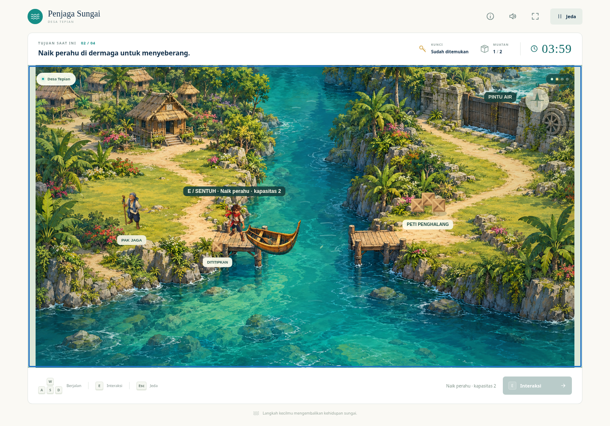

# Penjaga Sungai



Petualangan 2D pendamping STI7356 pertemuan 6–8, memakai ilustrasi asli, efek air, dialog, dan pilihan muatan. Pemain mengambil kunci di gudang, menyeberang dengan perahu warisan, membersihkan tiga peti, lalu membuka pintu air sebelum 240 detik habis. Paket tambahan bersifat opsional; paket dapat dititipkan jika muatan melebihi kapasitas.

- Keyboard: WASD atau tombol arah; E/Spasi untuk interaksi; Esc untuk jeda.
- HP/tablet: tombol arah dan tombol interaksi; kamera lebih dekat di layar sempit. Tampilan mendatar memakai kontrol di samping peta.
- Klik peta untuk berjalan menuju titik/objek terdekat; gunakan arah jika jalur langsung terhalang.
- Timer berhenti ketika percakapan, bantuan, jeda, atau tab tidak aktif.
- Setelah menang, pilih **Lihat sungai yang terselamatkan** untuk melihat pintu air terbuka.

[Catatan rancangan dan storyboard enam panel](docs.html) · [Dokumentasi yang dapat diedit](docs/rancangan.md) · [Asal aset](docs/aset.md)

## Menjalankan secara lokal

Tidak membutuhkan instalasi paket untuk memainkan game. Jalankan dari direktori repositori:

```sh
python3 -m http.server 8000
```

Buka alamat server tersebut di browser. Semua aset dimuat dari repositori, tanpa layanan game eksternal, login, atau database.

## GitHub Pages

Workflow `.github/workflows/pages.yml` menyiapkan situs statis dan menerbitkannya dengan GitHub Actions. Jika Pages belum aktif atau aktivasi otomatis tidak diizinkan oleh token workflow, pemilik repositori dapat membuka **Settings → Pages → Build and deployment → Source: GitHub Actions**, lalu menjalankan ulang workflow **Publish Penjaga Sungai** di tab Actions.

Alamat yang dituju setelah deployment berhasil: https://nouranisa.github.io/Pengembangan_aplikasi_game/

Status live harus diperiksa di tab Actions/Settings; keberadaan berkas game tidak sendiri membuktikan deployment berhasil.

## Pemeriksaan

Tes model tidak membutuhkan dependensi:

```sh
node tests/model.cjs
```

Tes browser memerlukan Playwright dan Chromium, dengan server lokal berjalan:

```sh
node tests/smoke.cjs
```

Konfigurasi opsional: `SUNGAI_TEST_URL`, `SUNGAI_TEST_OUTPUT`, `CHROMIUM_PATH`. Secara default tangkapan layar dan hasil JSON ditulis ke `/tmp/penjaga-sungai-qa`. Debug hook hanya muncul ketika halaman dibuka dengan `?test=1` dan tidak tersedia pada URL normal.

Rancangan mengacu pada PPT pertemuan 6–8, RPS, dan template OBE bagian 3.4–3.5. Game adalah contoh fiktif pembelajaran; cakupan penilaian UTS mengikuti dosen.
